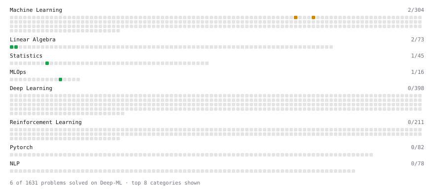

# Deep-ML

My machine learning practice from [Deep-ML](https://www.deep-ml.com). Every solution here was written by hand.

**5** solved · 5 problems · 0 labs · 0 math

[**Browse the interactive portfolio**](https://tongliuTL.github.io/deep-ml/) to replay this filling in over time.

## Problems

| | Difficulty | Solved | |
| --- | --- | --- | --- |
| [Estimate Minimum GPU Count for Model Deployment](https://www.deep-ml.com/problems/412) | easy | 2026-10-23 | [solution](problems/0412-estimate-minimum-gpu-count-for-model-deployment) |
| [Matrix-Vector Dot Product](https://www.deep-ml.com/problems/1) | easy | 2024-07-29 | [solution](problems/0001-matrix-vector-dot-product) |
| [Transpose of a Matrix](https://www.deep-ml.com/problems/2) | easy | 2024-07-29 | [solution](problems/0002-transpose-of-a-matrix) |
| [Calculate AUC (Area Under ROC Curve)](https://www.deep-ml.com/problems/277) | medium | 2026-10-20 | [solution](problems/0277-calculate-auc-area-under-roc-curve) |
| [Calculate Expected Calibration Error (ECE)](https://www.deep-ml.com/problems/260) | medium | 2026-10-21 | [solution](problems/0260-calculate-expected-calibration-error-ece) |

---

_This file is regenerated by Deep-ML on every push._
